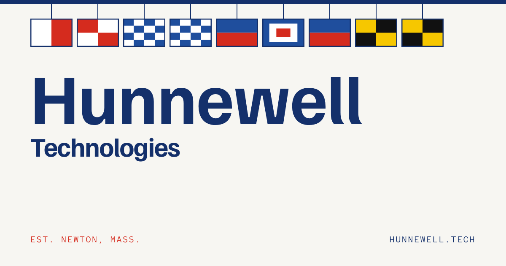

  

A small studio in Newton, Massachusetts that builds and runs products, datasets, and tools for maritime data, real estate projects, and fun things.

## Work

| | Product | What it is | Status |
|---|---|---|---|
|  | **[VesselProfile](https://vesselprofile.com)** | Names change. The vessel doesn’t. One profile per ship, with every name, flag and owner a hull has carried, checked against the official registers behind it every night. | Live |
|  | **[SendRepair](https://sendrepair.com)** | From drip to done, for owners of a few homes. Your tenant reports it, your contractors get it in the order you choose, and everyone hears by text when it’s fixed. | In development |
|  | **[Blockbook](https://blockbook.hunnewell.tech)** | A private directory of the providers Hunnewell Hill neighbors use. Claim your house on the map and get vouched in by a neighbor already on it. | Live, members |
|  | **[swapjaw](https://swapjaw.com)** | Party accents, one sound swap at a time. Dialect-coach lessons shrunk to your phone. | Live |
|  | **[Inkwell](https://inkwell.hunnewell.tech)** | Markdown, rendered the moment you open it. Read what a chat assistant wrote, fix a word, and paste it into Slack, Mail, or Word with the formatting intact. | Live, macOS |

## Lab

- **Rhumbline.** Sea routes, distances, and ETAs, computed over a network built from AIS tracks. *Prototype.*
- **Agent operations.** AI agents that take tickets, ship previews, and wait for a person to approve. *In daily use.*
- **Data provenance.** Pipelines that keep the source behind every number, so any figure traces back. *Powers VesselProfile.*
- **Own infrastructure.** Our own Kubernetes cluster, ingesting about 12 million AIS records a day. *Running.*

## About

Hunnewell builds and operates a small portfolio of products, datasets, and tools, and documents the experiments behind them. We keep the list short and make each one carefully: fast to use, accurate, and easy to trust.

**Contact:** [info@hunnewell.tech](mailto:info@hunnewell.tech) · [hunnewell.tech](https://hunnewell.tech)

© Hunnewell Technologies LLC · Newton, Mass.
